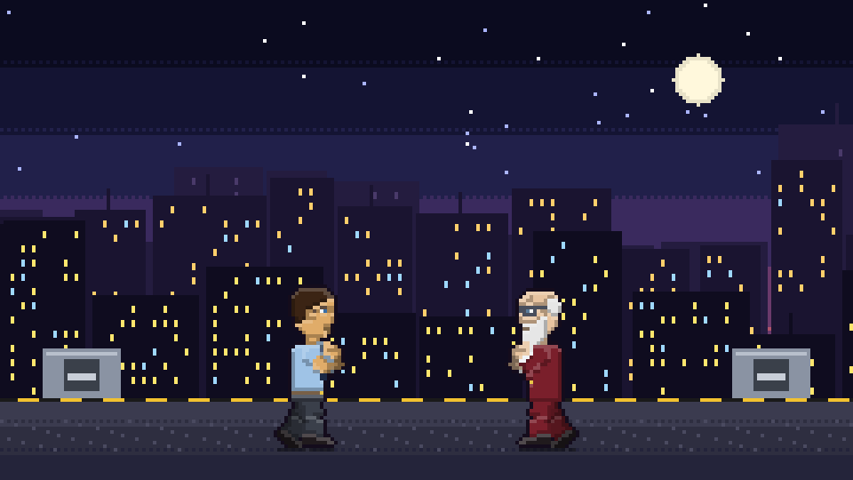
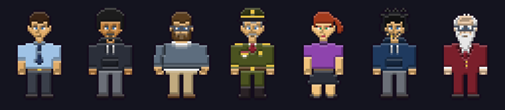
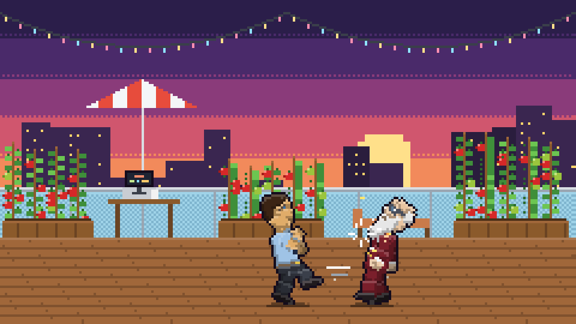
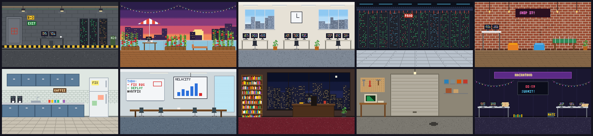
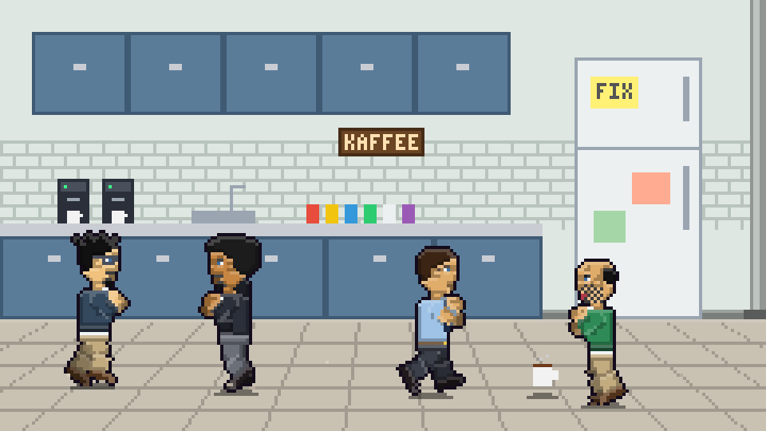

# SouthBeat

Ein 2D-Pixel-Art-Beat-'em-up als Webanwendung, gebaut mit Angular und Server-Side Rendering (SSR).



## Spielidee

- **Eigene Charaktere erstellen:** Im Charakter-Editor gestalten Spieler vor allem das Aussehen und die Moves ihrer Kämpfer.
- **Faire Werte:** Stats wie Stärke, Tempo oder Ausdauer lassen sich nur innerhalb eines vorgegebenen Rahmens verteilen, damit die Spielbalance erhalten bleibt.
- **Kämpfer:** Alle Kämpfer sind Programmierer, ihre Moves kommen vom Schreibtisch (Tastatur-Jab, Kaffee-Wurf, Merge-Konflikt …).
- **Schauplatz:** Gekämpft wird in Büros, vom Bunker-Office bis zur Dachterrasse.
- **Multiplayer:** Die erstellten Charaktere treten online gegeneinander an.

## Pixel-Art

Alles im Spiel ist Pixel-Art, die der Code selbst zeichnet: 240×135 Pixel große Szenen und 32×48 Pixel große Kämpfer. Die Bilder hier sind direkt aus dem Spielcode gerendert und ohne Glättung vergrößert (`npm run images` erzeugt sie neu in `docs/images`).

**Die Kämpfer:** dein Standard-Kämpfer, der Sparringspartner und die Einzelspieler-Leiter von Bernd Brummer bis zum Endboss Gustav Großmaul.



**Kampf** auf der Dachterrasse mit den Tomatenbeeten, gegen Gustav Großmaul:



**Die 10 Arenen:** Bunker-Office, Dachterrasse, Großraumbüro, Serverraum, Startup-Loft, Teeküche, Meetingraum, Chefbüro, Garagen-Start-up und Hackathon-Nacht.



**Stage-Modus** zu zweit durch die Teeküche:



## Stand

- **Titelbildschirm** (`/`): Animierter Pixel-Hintergrund wie bei klassischen Spielen: eine nächtliche Skyline scrollt in drei Parallax-Ebenen, Sterne funkeln, und auf dem Dach sparrt dein Kämpfer gegen wechselnde Bosse. Nach „PRESS START“ (beliebige Taste oder Klick) erscheint das Hauptmenü, steuerbar mit der eigenen Belegung (hoch/runter, Leicht oder Enter zum Bestätigen) oder per Maus. Die Szene steckt in `src/app/home/title-scene.ts`.

- **Charakter-Editor** (`/editor`): Name, Körperbau (normal, kräftig, schlank), Accessoire (Brille, Sonnenbrille, Headset, Offiziersmütze), Haut- und Augenfarbe, 7 Frisuren, 6 Bartstile, Haar-/Bartfarbe, 12 Outfits (Hemd mit Krawatte, Anzug, Business Casual, Bluse & Rock, Uniform, Karate-Gi, Tanktop, Lederjacke, Hoodie, Ninja, Wrestler, Rüstung) mit eigener Farbe, je ein Move pro Slot (leichter Schlag, schwerer Schlag, Tritt, Spezialangriff, ultimativer Angriff) und vier Werte mit Live-Pixel-Vorschau (32×48 Pixel mit Licht, Schatten und Umriss). Dazu 13 Schieberegler für die Proportionen (Körper: Größe, Statur, Schultern, Bauch, Kopfgröße, Armlänge, Beinlänge; Gesicht: Augen, Nase, Mund, Kinn, Bartlänge, Haarlänge), je 7 Stufen von −3 bis +3. Die Regler sind reine Optik: Reichweite, Tempo und Trefferzonen bleiben für alle Kämpfer gleich (`src/app/character/proportions.ts`, Gesicht in `profile.ts`). Der Server speichert sie mit dem Kämpfer und lehnt unbekannte Regler oder Werte außerhalb des Bereichs ab. Gespeichert wird über die Server-API in einer Datei (siehe unten).
- **Spezialangriffe** gibt es in vier Arten: Geschoss (Kaffee-Wurf, USB-Stick-Schuss), Bogenwurf (Tastatur-Bogenwurf), Sturmangriff (Deadline-Sprint) und Nahkampf (Merge-Konflikt, Stack Overflow). Bei geworfenen Angriffen zeichnet der Spieler sein Geschoss im Editor selbst (12×12 Pixel, 16 Farben, Vorlagen Kaffeetasse, Bug, Diskette, Tomate). Die Zeichnung wird mit dem Kämpfer gespeichert und im Kampf angezeigt.
- **Charakter aus Foto**: Im Editor lässt sich ein Foto auswählen. Der Browser erkennt daraus Hautfarbe, Frisur und Haarfarbe, Bart, Brille oder Sonnenbrille sowie Kleidung (Anzug, Hemd oder Casual) und übernimmt das ins Aussehen, das danach frei weiter bearbeitet werden kann. Die Auswertung läuft komplett lokal (`src/app/character/photo-analysis.ts`); das Foto wird weder hochgeladen noch gespeichert.
- **Balance-Regeln** (`src/app/character/balance.ts`): Jeder Wert liegt zwischen 1 und 10, insgesamt dürfen 22 Punkte verteilt werden. `characterErrors()` prüft einen kompletten Charakter, damit später auch der Server manipulierte Werte ablehnen kann.

- **Kämpferauswahl** (`/select`, Startseite „Freier Kampf“): Aufgebaut wie bei klassischen Prüglern. Oben steht ein Raster mit Porträts: dein Kämpfer, der Sparringspartner, alle Einzelspieler-Gegner und „Zufall“. Gustav Großmaul bleibt als Silhouette gesperrt, bis er im Einzelspieler besiegt ist. Unten hat jeder Spieler ein farbiges Panel (P1 rot, P2 blau, CPU grau) mit Figur, Rolle und Werten. Jeder Spieler steuert seinen eigenen Cursor (P1: WASD, J wählen, K zurück; P2: Pfeiltasten, Num 1 wählen, Num 2 zurück) oder klickt. Gegen die CPU wählt P1 nach dem eigenen Kämpfer auch den der CPU. „zu Spieler 2 wechseln“ macht daraus ein 2-Spieler-Match. Sind beide gewählt, startet „Bereit zum Kampf!“ die Arena-Auswahl. Die Online-Lobby nutzt dieselbe Auswahl.
- **Arenen** (`/arena`): 10 Büro-Arenen als Pixel-Art (Bunker-Office, Dachterrasse-Office, Großraumbüro, Serverraum, Startup-Loft, Teeküche, Meetingraum, Chefbüro, Garagen-Start-up, Hackathon-Nacht). Die Arena-Auswahl zeigt oben eine große Vorschau mit beiden gewählten Kämpfern und darunter alle Arenen plus „Zufall“ als Raster, steuerbar mit Tasten oder Maus. Gezeichnet wird in `src/app/arena/arenas.ts`.
- **Kampf** (`/fight`): Spielbarer Kampf gegen die CPU oder zu zweit an einer Tastatur, mit Lebens- und Action-Balken und 99-Sekunden-Timer. Der Action-Balken lädt sich mit der Zeit, durch Treffer und durch eingesteckte Treffer auf. Ist er voll, kann der Kämpfer seinen ultimativen Angriff starten (Freitags-Deploy, rm -rf /, Bluescreen oder Endlosschleife); er leert den Balken und lässt sich nicht unterbrechen. Die Regeln stecken in `src/app/fight/combat.ts`.

| | Laufen | Leicht | Schwer | Tritt | Spezial | Ultimate |
| --- | --- | --- | --- | --- | --- | --- |
| Spieler 1 | A / D | J | K | L | Ö | Ä |
| Spieler 2 | ← / → | Num 1 | Num 2 | Num 3 | Num 4 | Num 5 |

Springen mit W bzw. ↑, Ducken mit S bzw. ↓. Ö und Ä beziehen sich auf die deutsche Tastatur.

Die Tabelle zeigt die Standardbelegung. Unter **Steuerung** (`/controls`, Startseite) lässt sich jede Taste für Spieler 1 und Spieler 2 neu belegen: Feld anklicken, neue Taste drücken, Esc bricht ab. Ist die Taste schon belegt, tauschen die beiden Belegungen. „Standard“ setzt einen Spieler zurück. Die Belegung wird im Browser gespeichert und gilt damit pro PC; im Online-Kampf spielt jeder mit seinen eigenen Tasten für Spieler 1.

Das Kampfsystem orientiert sich an Street Fighter:

- **Blocken**: Vom Gegner weg halten blockt. Stehend blockst du mittlere Angriffe und Sprungangriffe, geduckt (zurück + unten) mittlere Angriffe und Feger. Geblockte Normalangriffe machen keinen Schaden, Spezialangriffe und Ultimates ziehen ein Viertel ab. Nach einem Block steckt man kurz im Blockstun.
- **Springen**: Gerade oder schräg nach vorn bzw. hinten. Geschosse lassen sich überspringen. Angriffe in der Luft sind Sprungangriffe und müssen stehend geblockt werden; die Landung beendet sie.
- **Ducken**: Geduckt werden die Normalangriffe zu Ducktechniken. Leicht ist ein schneller Duckschlag, Schwer ein Anti-Air-Aufwärtshaken, der auch Springer trifft, und Tritt ein Feger, der nur geduckt blockbar ist und umwirft.
- **Umwerfen**: Feger und Treffer in der Luft werfen den Gegner zu Boden. Am Boden liegend kann er nicht getroffen werden.
- **Spezial-Eingabe**: ↓ ↘ → plus Leicht, Schwer oder Tritt löst den Spezialangriff aus, wie ein Hadouken. Die Spezialtaste geht weiterhin.
- **CPU**: Die CPU blockt einen Teil der Angriffe (bei Fegern geduckt), springt ab und zu rein und kontert Sprünge mit dem Aufwärtshaken.
- **Seitenansicht**: Im Spiel werden die Figuren von der Seite gezeichnet (`src/app/character/profile.ts`, mit allen Frisuren, Bärten, Outfits, Accessoires und Körperformen aus dem Editor) und schauen sich im Zweikampf an. Im Stage-Modus blicken Gegner immer zu ihrem Ziel, auch wenn sie zurückweichen. Editor-Vorschau, Arena-Vorschau und Einzelspieler-Liste zeigen ebenfalls die Seitenansicht; nur die Gesichter in der Kämpferauswahl bleiben frontal.
- **Animationen**: Oberarme, Unterarme, Oberschenkel, Unterschenkel, Kopf und Oberkörper bewegen sich einzeln, mit Ellbogen und Knien (`src/app/fight/pose.ts`, Posen in `animate.ts`). Deckung mit erhobenen Fäusten. Kampfhaltung mit Atmen, Laufzyklus, Sprung, Ducken, Block, jeder Angriff mit Ausholen, Treffer und Zurückziehen, Treffer-Reaktion, Hinfallen und Aufstehen, Siegerpose. Bei Treffern friert das Spiel kurz ein (Hitstop, je nach Härte 4 bis 12 Bilder), dazu Trefferblitz mit Funkenflug, Bildschirmwackeln bei harten Treffern und Staubwolken bei Landungen und Stürzen (`effects.ts`). Gilt im Zweikampf, Einzelspieler, Stage-Modus, online und auf dem Titelbildschirm.

- **Training** (`/training`, Startseite „Training“): Ein Dummy, der nie umfällt (steht, duckt sich, blockt alles, springt oder wehrt sich als CPU), eine Uhr ohne Ende und auf Wunsch ein immer voller Action-Balken. Trefferboxen zeigen, wo ein Kämpfer getroffen werden kann (grün) und wohin ein Angriff reicht (gelb beim Ausholen, rot wenn er trifft). Die Eingabe-Anzeige links oben schreibt die letzten Eingaben in Prügler-Schreibweise aus Sicht des Kämpfers (→ ist immer nach vorn), ein Zähler rechts oben zeigt Treffer in Folge und ihren Schaden. Logik in `src/app/fight/training.ts`.
- **Kämpfer & Bestenliste** (`/fighters`): „Meine Kämpfer“ zeigt alle in diesem Browser erstellten Kämpfer; dort wechselst du, wer spielt, bearbeitest oder legst einen neuen an. „Alle Kämpfer“ listet die Kämpfer aller Spieler mit Suche und Online-Bilanz. „Kämpfen“ oder „In die Auswahl“ setzt bis zu 8 davon als Rivalen auf den Auswahlbildschirm, gespielt vom Computer. „Bestenliste“ zeigt die Top 10 nach Online-Siegen.
- **Einzelspieler** (`/singleplayer`): Eine Gegnerleiter durch die Chefetage. Jeder Sieg schaltet den nächsten Gegner frei, der Fortschritt landet in der Datendatei.

| Gegner | Rolle | Stil | Arena |
| --- | --- | --- | --- |
| Bernd Brummer | Co-Teamleiter | Kräftig, Bart und Brille, Bauch-Schubser mit riesigem Rückstoß, Ultimate Pflicht-Meeting (Kalendereinladungen) | Teeküche |
| Konrad Kettner | Teamleiter | Panzer-General, Spezialattacke Panzer-Walze rollt über die ganze Arena, Ultimate Umstrukturierung (Organigramm-Kästen stürzen herab) | Bunker-Office |
| Lena Flink | HO | Sehr schnell, Kombo-Angriffe mit mehreren Treffern pro Taste, Ultimate Sprint-Endspurt (5 Treffer) | Meetingraum |
| Ralf Rackwitz | CTO | Rack-Schlag mit Server-Bauteilen, wirft Festplatten, Ultimate Kernel Panic | Serverraum |
| Gustav Großmaul | CSO, Endboss | Alter Mann mit langem Bart, wirft Tomaten (Ultimate Tomatenhagel), redet ununterbrochen und verspricht Kunden Features, die weder abgestimmt noch implementiert sind | Dachterrasse-Office mit Tomatenbeeten |

Jeder Boss hat eine eigene Ultimate, die Spieler nicht wählen können. Spieler wählen im Editor aus acht Ultimates: Freitags-Deploy, rm -rf /, Bluescreen, Endlosschleife, git push --force, Hotfix in Prod, DDoS-Flut und Legacy-Code. Langsamere Ultimates machen mehr Schaden (Schaden minus halbe Ausholzeit ist bei allen etwa gleich). Alle Ultimates brauchen eine volle Action-Leiste, auch bei Bossen. Die Effekte stehen in `src/app/fight/ultimates.ts`.

Die Gegner sprechen in Sprechblasen am oberen Bildschirmrand. Die Sprechblasen sind rein kosmetisch und beeinflussen das Spiel nicht. Gegner und Sprüche stehen in `src/app/singleplayer/opponents.ts`. Außerdem sagen alle Kämpfer, auch in normalen Kämpfen und im 2-Spieler-Modus, hin und wieder etwas, wenn sie getroffen werden: Spieler 1 links oben, Spieler 2 rechts oben. Jeder Gegner hat dafür eigene Sprüche, alle anderen nutzen die allgemeinen aus `src/app/fight/hit-lines.ts`.

Online spielen geht im Zweikampf und im Stage-Modus, siehe „Online-Kampf“ unten.

## Stage-Modus (Koop)

Unter `/stages` (Startseite: „Stage-Modus (Koop)“) geht es wie in klassischen Beat 'em ups von links nach rechts durch fünf Stages: Teeküche, Bunker-Office, Meetingraum, Serverraum und Dachterrasse-Office. Gespielt wird allein, zu zweit an einer Tastatur oder mit einem CPU-Partner; jeder wählt seinen Kämpfer in der Kämpferauswahl.

- **2,5D**: Die Arenen sind auf drei Bildschirme verlängert und haben Bodentiefe. Mit Springen/Ducken-Tasten (W/S bzw. ↑/↓) läuft man nach hinten und vorn. Figuren werden nach Tiefe sortiert gezeichnet, und Angriffe treffen nur Gegner auf ungefähr derselben Tiefe.
- **Wellen**: Pro Bildschirm kommen Gegnerwellen von beiden Seiten. Sind alle besiegt, erscheint „GO →“ und die Kamera scrollt weiter. Jedes Büro hat seine eigene Mischung, spätere Stages schicken mehr und zähere Gegner. Getroffene Gegner geben ab und zu einen Spruch von sich.
- **Gegner aus dem Büroalltag**:
  - *Praktikant*: schwach, aber viele.
  - *Berater*: zäh, schießt mit USB-Sticks.
  - *Scrum Master*: schnell, wirft Tastaturen im Bogen.
  - *Product Owner*: „Ticket-Flut“ wirft drei Tickets auf einmal, über die ganze Tiefe verteilt.
  - *QA-Testerin*: schnelle Dreifach-Stiche („Edge-Case-Stich“) und Bug-Reports, die über den Boden krabbeln.
  - *IT-Support*: „Aus- und wieder an“ lähmt über eine Sekunde, die LAN-Kabel-Peitsche reicht weit.
  - *Recruiterin*: sehr schnell, der Headhunter-Sprint überbrückt große Abstände.
  - *Vertriebler*: Visitenkarten fliegen schnell und weit, der Golfschwung schleudert dich weg.
  - *Hausmeister*: gepanzert, leichte Schläge und Tritte halten ihn nicht auf (blaue Funken); Wischmop mit großer Reichweite und Putzeimer-Würfe.
- **Bosse**: Am Ende jeder Stage wartet der Einzelspieler-Gegner dieser Arena mit seinen Spezialangriffen und Sprüchen, als letzter Gustav Großmaul.
- **Gegenstände**: Kaffee (+20 Leben) und Pizza (+50) liegen auf der Karte, besiegte Gegner lassen manchmal Kaffee fallen. Eine Tastatur als Waffe macht die nächsten 10 Schläge um 60 % stärker. Aufgehoben wird durch Drüberlaufen.
- **Leben**: Jeder Spieler hat drei Leben; Leben und Action-Balken gehen in die nächste Stage mit. Sind alle raus, ist Game Over, die Stage lässt sich neu starten.

Die Regeln stecken in `src/app/stage/brawl.ts`, der Ablauf über alle Stages in `src/app/stage/campaign.ts` und die Stages und Gegnertypen in `src/app/stage/stages.ts`. Der Stage-Modus lässt sich auch online zu zweit spielen (siehe unten).

## Online-Kampf

Unter `/online` (Startseite: „Online-Kampf“) kämpfen zwei Spieler an zwei PCs in Echtzeit gegeneinander. Jeder wählt zuerst seinen Kämpfer in der Kämpferauswahl. Danach zeigt eine Lobby-Tabelle alle offenen Lobbys mit Name, Host und Arena; sie aktualisiert sich live. Ein Klick auf „Beitreten“ startet den Kampf sofort. Wer selbst hostet, gibt der Lobby einen Namen und wählt den Spielmodus: **Zweikampf** (gegeneinander, mit Arena oder „Zufällig“) oder **Stage-Modus** (zusammen durch alle fünf Stages, die Arenen geben die Stages vor). Die Tabelle zeigt den Modus jeder Lobby. Der Gast bringt nur seinen Kämpfer mit. Als Ausweichweg geht weiterhin der vierstellige Raumcode. Gespielt wird an jedem PC mit den Tasten von Spieler 1. Nach dem Kampf ist eine Revanche möglich; im Stage-Modus versuchen beide nach einem Game Over die Stage nochmal, nach der letzten Stage geht es von vorn los. Besiegte Bosse zählen für jeden Spieler im Einzelspieler-Fortschritt, wie im lokalen Stage-Modus. Sind beide Kämpfer selbst erstellt und gespeichert, zählt das Ergebnis in der Statistik.

Kampf und Stage laufen auf dem Server (`src/server/online.ts`, WebSocket unter `/online` auf demselben Port). Die Browser schicken nur ihre Tasten und zeichnen die Bilder, die der Server zurückschickt: im Zweikampf 60-mal, im Stage-Modus 30-mal pro Sekunde. Beide sehen dadurch immer denselben Kampf, und niemand kann am eigenen Browser schummeln.

- **Vorhersage**: Im Zweikampf misst der Browser die Laufzeit zum Server und spielt die eigenen, beim Server noch nicht angekommenen Eingaben auf einer Kopie vorab (höchstens 10 Bilder). Der eigene Kämpfer reagiert dadurch sofort, auch übers Internet; das nächste Bild vom Server korrigiert falsche Annahmen.
- **Datenmenge**: Moves gehen als ID über die Leitung, Kommazahlen werden gerundet, größere Nachrichten komprimiert. Gemessen etwa 19 KB/s im Zweikampf und 18 KB/s im Stage-Modus pro Spieler (vorher 35 und 108).
- **Verbindungsabbruch**: Bricht die Verbindung mitten im Spiel ab, hält der Server das Spiel bis zu 15 Sekunden an, beide sehen einen Hinweis, und der Browser verbindet sich mit einem geheimen Platz-Schlüssel neu. Wer bewusst geht oder den Tab schließt, beendet den Raum sofort.

Zum Spielen über zwei PCs im selben Netz:

```bash
npm run build
NG_ALLOWED_HOSTS=192.168.1.20 npm run serve:ssr:southbeat   # IP des PCs, auf dem der Server läuft
```

Beide öffnen dann `http://192.168.1.20:4000/online`. Für Spiele übers Internet muss der Server öffentlich erreichbar sein. `ng serve` unterstützt den Online-Kampf nicht, dafür braucht es den gebauten Server.

## Speicherung

Erstellte Kämpfer und Spielstatistiken (Matches, Siege, Niederlagen, Arenen) speichert der SSR-Server in einer JSON-Datei, standardmäßig `data/southbeat.json` (per `SOUTHBEAT_DATA_FILE` änderbar, von Git ignoriert). Der Browser merkt sich die IDs seiner Kämpfer und zu jedem einen Bearbeitungsschlüssel.

| Methode | Pfad | Zweck |
| --- | --- | --- |
| GET | `/api/fighters` | alle Kämpfer (ohne Schlüssel) |
| GET | `/api/fighters/:id` | ein Kämpfer mit Bilanz und Ladder-Fortschritt |
| POST | `/api/fighters` | Kämpfer anlegen, Antwort enthält einmalig `editToken` |
| PUT | `/api/fighters/:id` | Kämpfer ändern, nur mit Header `X-Edit-Token` |
| POST | `/api/fighters/:id/ladder` | Ladder-Kampf speichern, nur mit `X-Edit-Token` und in Ladder-Reihenfolge |
| GET | `/api/stats` | Gesamtstatistik und Rangliste |

Schutz vor Manipulation, ohne Login:

- Jeder Kämpfer hat einen Bearbeitungsschlüssel. Der Server speichert nur dessen SHA-256-Hash; ändern kann ihn nur der Browser, der ihn angelegt hat. Kämpfer aus älteren Versionen ohne Schlüssel bekommen ihn beim ersten Speichern.
- Online-Ergebnisse zählt der Server selbst, und nur wenn beide Spieler ihren Schlüssel mitgeschickt haben. Browser können keine Ergebnisse mehr einreichen.
- Der Server prüft jeden Kämpfer gegen die Balance-Regeln und die Ladder-Reihenfolge.
- Grenzen: 600 Anfragen pro Minute, 60 Änderungen pro Minute und 20 neue Kämpfer pro Stunde je IP; höchstens 5000 Kämpfer, 200 offene Online-Räume, 8 Online-Verbindungen je IP und 120 Nachrichten pro Sekunde je Verbindung.
- Sicherheits-Header (Content-Security-Policy, `X-Frame-Options`, `nosniff`, kein `X-Powered-By`) und gzip-Kompression.

### Datendatei, Wachstum und Backup

Jede Änderung schreibt die ganze Datei, zuerst in eine temporäre Datei und dann per Umbenennen, damit ein Absturz nie eine halbe Datei hinterlässt. Kommen während eines Schreibvorgangs weitere Änderungen, werden sie danach gemeinsam geschrieben. Damit die Datei nicht endlos wächst, werden ab 20.000 Online-Kämpfen die ältesten zu Summen je Kämpfer und Arena zusammengefasst (Bilanzen und Bestenliste bleiben gleich), und ab 20.000 Einzelspieler-Ergebnissen bleibt pro Kämpfer und Gegner nur der erste Sieg. Zusammen mit der Grenze von 5000 Kämpfern bleibt die Datei bei einigen MB.

Backup des Docker-Volumes:

```bash
docker run --rm -v southbeat_southbeat-data:/data -v "$PWD":/backup alpine tar czf /backup/southbeat-data.tgz -C /data .
```

Zurückspielen mit `tar xzf` in dasselbe Volume bei gestopptem Container. Ohne Docker reicht eine Kopie von `data/`. Für einen großen öffentlichen Server wäre SQLite (z. B. `better-sqlite3`) der nächste Schritt; `GameDataRules` enthält keine Datei-Logik, nur `JsonFileStorage` müsste ersetzt werden.

## Eigene Inhalte und Content-Studio

Neue Gegner, Arenen, Kämpfer und Attacken kommen als JSON-Inhaltspakete ins Spiel. Der Server prüft jedes Paket gegen die Balance-Regeln (Schadens-Budget je Attacke, Statuspunkte, gültige Werte) und lädt es beim Start.

**Im Spiel:** Menüpunkt *Content-Studio* (`/studio`). Du beschreibst in Worten, was du willst, eine KI baut daraus ein Paket, prüft es mit den Spielregeln und korrigiert Fehler selbst. Du siehst Arena, Figuren und Attacken als Vorschau und übernimmst sie mit einem Klick. Pakete lassen sich auch als JSON einfügen, herunterladen und wieder entfernen.

**KI-Anbindung** (im Studio einstellbar oder per Umgebungsvariable):

| Anbieter | Adresse | Key |
| --- | --- | --- |
| Ollama (lokal) | `http://localhost:11434/v1` | keiner |
| LM Studio (lokal) | `http://localhost:1234/v1` | keiner |
| llama.cpp-Server | `http://localhost:8080/v1` | keiner |
| OpenAI oder andere OpenAI-kompatible Dienste | z. B. `https://api.openai.com/v1` | ja |
| Anthropic Claude | leer lassen | ja, oder `ANTHROPIC_API_KEY` des Servers |

Der Key bleibt auf dem Server (`data/studio-settings.json`, nur für den Server lesbar) und wird nie an Browser geschickt. Das Studio ändert, was alle Spieler sehen: Ohne `SOUTHBEAT_STUDIO_PASSWORD` ist es nur auf dem PC erreichbar, auf dem der Server läuft. Im Docker-Container ist deshalb ein Passwort nötig.

**Für Coding-Agenten** (Claude Code & Co.): siehe [AGENTS.md](AGENTS.md). Kurz: Paket nach `content/packs/` legen und prüfen.

```bash
npm run content -- reference                 # Spielwerte und Regeln
npm run content -- validate meine-datei.json # prüfen
npm run content -- add meine-datei.json      # prüfen und nach content/packs kopieren
```

Das Schema liegt in `content/schema/content-pack.schema.json`, ein vollständiges Beispiel in `content/examples/netzwerk-pack.json`.

## Docker

Das Image enthält den kompletten Server: Spielseiten, API, Speicherung und Online-Server auf einem Port.

```bash
docker build -t southbeat .
docker run -d -p 4000:4000 -v southbeat-data:/app/data --name southbeat southbeat
```

Danach läuft SouthBeat auf `http://localhost:4000`. Kämpfer, Statistiken und Ladder-Fortschritt liegen im Volume `southbeat-data` und bleiben bei Neustarts und Updates erhalten.

Fertige Images gibt es auch bei GitHub Packages. Der CI-Workflow baut und veröffentlicht sie, sobald alle Tests grün sind: `latest` und `sha-…` für jeden Stand auf `main`, dazu `1.2.3`, `1.2` und `1` für einen Tag `v1.2.3`.

```bash
docker run -d -p 4000:4000 -v southbeat-data:/app/data --name southbeat ghcr.io/damaurer/southbeat:latest
```

Oder mit Docker Compose:

```bash
docker compose up -d
```

Für Spiele im lokalen Netz muss der Server die Adresse kennen, unter der die anderen PCs ihn aufrufen: `docker run … -e NG_ALLOWED_HOSTS=192.168.1.20 …` bzw. `SOUTHBEAT_HOST=192.168.1.20 docker compose up -d`. Sonst antwortet er auf diese Adresse mit Fehler 400.

| Variable | Standard | Zweck |
| --- | --- | --- |
| `PORT` | `4000` | Port im Container |
| `SOUTHBEAT_DATA_FILE` | `/app/data/southbeat.json` | Speicherdatei |
| `NG_ALLOWED_HOSTS` | – | zusätzliche Hostnamen/IPs, kommagetrennt |
| `TRUST_PROXY` | – | hinter einem Reverse Proxy `1`, damit die Limits die echte IP sehen |
| `SOUTHBEAT_STUDIO_PASSWORD` | – | Passwort für das Content-Studio (im Container nötig) |
| `SOUTHBEAT_LLM_PROVIDER` | `openai` | `openai` (alles OpenAI-kompatible) oder `anthropic` |
| `SOUTHBEAT_LLM_BASE_URL` | Ollama | Adresse des LLM-Servers; Ollama auf dem Host: `http://host.docker.internal:11434/v1` |
| `SOUTHBEAT_LLM_MODEL` | `llama3.1` bzw. `claude-opus-5-5` | Modell |
| `SOUTHBEAT_LLM_API_KEY` | – | API-Key, falls nötig |
| `SOUTHBEAT_CONTENT_DIR` | `content/packs` | mitgelieferte Inhaltspakete |

Falls Docker Hub das Herunterladen des Node-Basisimages begrenzt („429 Too Many Requests“), geht ein Spiegel: `docker build --build-arg NODE_IMAGE=mirror.gcr.io/library/node:22-alpine -t southbeat .`

## Entwicklung

Voraussetzung: Node.js 22 oder neuer.

```bash
npm install
npm start            # Dev-Server auf http://localhost:4200
npm run build        # Produktions-Build inkl. SSR
npm run serve:ssr:southbeat   # gebaute SSR-App starten (Port 4000)
npm test             # Unit-Tests (Browser)
npm run test:server  # Server-Tests (Node, z. B. Online-Räume)
npm run lint         # ESLint mit Angular- und Barrierefreiheits-Regeln
npm run e2e          # Playwright-Smoke-Tests gegen den gebauten Server (vorher npm run build)
```

Die Smoke-Tests (`e2e/smoke.spec.ts`) gehen Startmenü, Kampf, Training, Online-Lobby mit zwei Browsern und die Kämpferliste durch und starten dafür einen eigenen Server mit leerer Datendatei. Ist Chromium schon installiert, zeigt `PLAYWRIGHT_CHROMIUM=/pfad/zu/chrome` darauf, sonst einmal `npx playwright install chromium`.

`.github/workflows/ci.yml` führt bei jedem Push auf `main`, jedem Versions-Tag und jedem Pull Request Lint, Build, Browser-, Server- und Smoke-Tests aus und prüft die Beispiel-Content-Packs. Sind alle grün (nicht bei Pull Requests), baut er das Docker-Image und veröffentlicht es als `ghcr.io/damaurer/southbeat` (siehe „Docker“).
